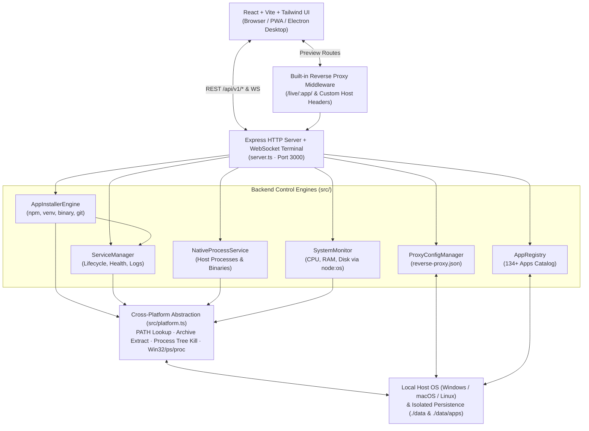

# KATHAL OS

**Open-source, 100% self-hosted application hosting, service manager, and local infrastructure control panel** — inspired by Coolify, Dokploy, and CasaOS, engineered to run natively on **Windows, macOS, and Linux** with **zero cloud accounts and zero mandatory Docker**.

[](https://nodejs.org/)
[](https://www.typescriptlang.org/)
[](https://vitejs.dev/)
[](#cross-platform-support-matrix)
[](#security--local-first-guarantees)
[](#license)

> **Why "Kathal"?** *Kathal* means **jackfruit** — reflected in KATHAL OS's dark forest (`#080C08` / `#101A10`) interface with green, yellow, and red operational telemetry: rugged on the outside, richly packed with self-hosted modules inside.

---

## Table of Contents

- [Highlights](#highlights)
- [Features](#features)
- [Quick Start](#quick-start)
  - [Prerequisites](#prerequisites)
  - [Windows (PowerShell)](#windows-powershell)
  - [macOS](#macos)
  - [Linux](#linux)
  - [Desktop App (Electron) & PWA](#desktop-app-electron--pwa)
  - [First-Time Administrator Setup](#first-time-administrator-setup)
- [Architecture](#architecture)
- [Repository Layout](#repository-layout)
- [Cross-Platform Support Matrix](#cross-platform-support-matrix)
- [App Store Catalog (134+ Apps)](#app-store-catalog-134-apps)
- [Configuration & Persistence](#configuration--persistence)
- [API & WebSocket Reference](#api--websocket-reference)
- [Security & Local-First Guarantees](#security--local-first-guarantees)
- [Development & Verification](#development--verification)
- [Uninstalling](#uninstalling)
- [License](#license)

---

## Highlights

- **Cross-Platform Native Execution**: Runs directly on **Windows 10/11/Server**, **macOS (Apple Silicon & Intel)**, and **Linux (`x64` & `arm64`)** using a unified OS abstraction (`src/platform.ts`).
- **Zero Cloud, Zero Mandatory Docker**: Every service, database, config file, and backup lives on your own machine (`./data`). **114 of 134 catalog apps** install and run natively without Docker; the remaining **20 Docker-dependent apps** are transparently labeled.
- **134+ Curated App Store & Installer Engine**: Automated preflight checks, isolated app workspaces (`./data/apps/<app>`), `.env` and config templating, automatic free port allocation, live install streaming logs, HTTP/TCP health checks, and start/stop/restart lifecycle controls.
- **Dedicated Service Engine & Native Process Monitor**: Inspect OS-level running processes (`PID`, `CPU%`, `Memory`, `Threads`, `Uptime`) distinctly from managed workloads across Windows (`Win32_Process`), macOS (`ps`), and Linux (`/proc`).
- **Built-In Reverse Proxy & Local Domains**: Route custom domains (e.g. `myapp.local` → `http://127.0.0.1:8080`) or `/live/<appName>/` URLs directly through KATHAL's built-in HTTP proxy backed by `data/reverse-proxy.json`.
- **Desktop & Browser-Ready**: Run in any browser on port `3000`, install as an offline-capable **PWA**, or launch the standalone **Electron** desktop window (`npm run desktop`).

---

## Features

| Area | Capabilities |
| :--- | :--- |
| **Dashboard & `SystemMonitor`** | Real-time CPU utilization, core count & load averages, RAM usage, OS disk mount stats (`fs.statfsSync`), host uptime, and a 60-sample (1s interval) telemetry ring buffer. |
| **134+ App Store & `AppInstallerEngine`** | Search/filter by category, runtime, difficulty, popularity, favorites, or featured status. Dedicated detail pages with official links, GitHub repo, docs, requirements, preflight check, config templates, and troubleshooting guides. |
| **Service Engine (`ServiceManager`)** | Spawns and tracks native services via `node:child_process`, maintains persistent state (`data/services-state.json`), records `stdout`/`stderr`/`system` logs, polls HTTP/TCP health endpoints, and tracks resource history. |
| **Native Process Manager** | Distinct view listing live OS processes + custom launched host binaries/scripts with real-time CPU%, memory footprint, PID, working directory checks, and HTTP probing. |
| **Domains & Reverse Proxy** | Dual routing: instant `/live/<appName>/` path proxy plus custom `Host`-header domain mappings saved to `data/reverse-proxy.json`, with connection testing and enable/disable toggles. |
| **Web Terminal & File Manager** | Single-use ticket-authenticated WebSocket terminal (`/api/v1/terminal/ws/:id?ticket=<wsTicket>`) and browser-based File Manager supporting directory browsing, editing, uploads (`50 MB` limit), renaming, and deletion. |
| **Fleet, Audit & DevOps** | Local & remote node inventory with TCP reachability probes (`/api/v1/fleet/servers`), persistent audit log (`/api/v1/audit`), HMAC-signed Git webhook deploys, Compose viewer/scanner, masked/encrypted env secrets, database manager, and compressed ZIP backup export/restore. |

---

## Quick Start

### Prerequisites

- **Required**: **Node.js 20+** (`npm` included)
- **Optional** *(only needed when installing apps that use these runtimes)*:
  - **Python 3.10+** (with `venv` / `pip`) for Python AI, automation, and utility apps
  - **Git** for Git-based source deployments
  - **Docker** *(optional — only for the 20 apps explicitly flagged as `docker-required`)*

### Windows (PowerShell)

```powershell
git clone https://github.com/Kathal-OS/Kathal.git kathal-os
cd kathal-os
powershell -ExecutionPolicy Bypass -File scripts/install.ps1
npm run dev
```

Optional: Register a Windows Scheduled Task (`KathalOS`) to auto-start on user login:

```powershell
powershell -ExecutionPolicy Bypass -File scripts/install.ps1 -RegisterStartupTask
```

### macOS

```bash
git clone https://github.com/Kathal-OS/Kathal.git kathal-os
cd kathal-os
bash scripts/install-mac.sh
npm run dev
```

Optional: Install and start a background `launchd` LaunchAgent (`~/Library/LaunchAgents/com.kathal.dashboard.plist`):

```bash
KATHAL_INSTALL_LAUNCHD=1 bash scripts/install-mac.sh
```

> If Node.js is missing on macOS and Homebrew is installed, `install-mac.sh` offers automatic installation via `brew install node@22 python git`.

### Linux

```bash
git clone https://github.com/Kathal-OS/Kathal.git kathal-os
cd kathal-os
bash scripts/install.sh
npm run dev
```

The Linux installer creates `./data` and `./data/apps`, installs npm dependencies, builds the frontend, verifies TypeScript types, and prints a ready-to-paste `systemd` unit file if you wish to run KATHAL OS as a system service.

### Desktop App (Electron) & PWA

Launch KATHAL OS inside a native desktop window on Windows, macOS, or Linux (Electron automatically boots the local backend if port `3000` is not already active):

```bash
npm run desktop
```

Or install KATHAL OS directly from Chrome/Edge/Safari using the built-in **PWA Install** button in the top bar.

### First-Time Administrator Setup

1. Open **http://127.0.0.1:3000** in your browser (or launch `npm run desktop`).
2. If `KATHAL_ADMIN_PASSWORD` is unset, KATHAL OS prompts you on `/login` to claim the initial **Owner** account on first run.
3. Sign in to receive an `HttpOnly` session cookie (plus Bearer session token for CLI/API clients) with full Role-Based Access Control (`Owner`, `Administrator`, `Operator`, `Developer`, `Viewer`).

---

## Architecture



---

## Repository Layout

```text
.
├── server.ts                  # Express API gateway, reverse proxy, WebSocket upgrade & Vite/static serving
├── electron/
│   └── main.cjs               # Cross-platform Electron desktop wrapper & backend supervisor
├── scripts/
│   ├── install.ps1            # Windows installer + optional Scheduled Task registration
│   ├── install-mac.sh         # macOS installer + optional launchd LaunchAgent setup
│   └── install.sh             # Linux installer + systemd unit template output
├── src/
│   ├── config/                # RuntimeConfig loader & session/policy env parsing
│   ├── database/              # DatabaseManager (node:sqlite WAL/FK/backups), schema migrations & JSON-to-SQLite migrator
│   ├── repositories/          # PlatformRepository transactional SQLite sync & hydration
│   ├── security/              # VaultManager (AES-256-GCM v2 + key rotation) & scrypt/bcrypt password hashing
│   ├── auth/                  # AuthService (revocable sessions, lockout, resets) & 5-role/26-perm RbacService
│   ├── audit/                 # AuditService with recursive secret redaction & paginated queries
│   ├── fleet/                 # FleetService with DNS-resolving SSRF checks, TCP probes & agent heartbeats
│   ├── middleware/            # Cookie/Bearer authMiddleware, CSRF Origin check, requirePermission & rate limiter
│   ├── websocket/             # TerminalGateway (Origin check, single-use wsTicket, per-user cap, session teardown)
│   ├── routes/                # Modular routers: authRoutes, userRoutes, vaultRoutes, fleetRoutes, auditRoutes, databaseAdminRoutes
│   ├── platform.ts            # OS detection, PATH search, venv resolution, archive extraction, process kill/metrics
│   ├── installerEngine.ts     # Preflight checks, runtime probes, isolated app installs, health verification
│   ├── serviceManager.ts      # Native child-process lifecycle, persistent state, log capture, health polling
│   ├── serviceEngine.ts       # Service engine exports and helpers
│   ├── nativeProcess.ts       # Host OS process table scanner & standalone native binary manager
│   ├── localRuntime.ts        # Confined app directories, domain/proxy/Git URL validation, HTTP probing
│   ├── systemMonitor.ts       # Real-time CPU, memory, and disk usage collector (node:os + fs.statfsSync)
│   ├── proxyConfig.ts         # JSON config manager for reverse-proxy.json
│   ├── persistence.ts         # Legacy Phase 1 PersistenceManager preserved for import compatibility
│   ├── backupManager.ts       # Zero-dependency compressed PKZIP export & Zip-Slip/CRC-safe restore
│   ├── updateChecker.ts       # Semver comparator & GitHub Releases auto-update checker
│   ├── appRegistry.ts         # Central registry loader/serializer (data/registry.json)
│   ├── templates.ts           # Registry & template lookup/search API helpers
│   ├── templateTypes.ts       # Shared TypeScript interfaces for apps, health checks, and install commands
│   ├── catalogPart1.ts        # Curated app definitions (part 1)
│   ├── catalogPart2.ts        # Curated app definitions (part 2)
│   ├── catalogPart3.ts        # Curated app definitions (part 3)
│   └── store.ts               # In-memory operational state & monitoring ring buffer
├── tests/
│   ├── core.test.ts           # Core unit & HTTP/WebSocket security integration tests (12 tests)
│   └── phase1_5.test.ts       # SQLite, Auth, RBAC, Vault v2, WS, Audit & Fleet integration tests (11 tests)
├── docs/
│   ├── AUDIT_AND_ARCHITECTURE.md     # Repo audit, architecture blueprints, threat model & Phases 0–6 roadmap
│   ├── PHASE_1_5_AUDIT.md            # Phase 1.5 severity-classified audit findings
│   ├── DATABASE_MIGRATION.md         # SQLite schema, migrations, hot backup & JSON-to-SQLite migration
│   ├── VAULT_SECURITY.md             # Vault v2 encryption format, lock/recovery & Owner key rotation
│   ├── RBAC_AND_AUTHENTICATION.md    # scrypt auth, HttpOnly sessions, CSRF & 5-role/26-perm RBAC matrix
│   ├── FLEET_AGENT_PROTOCOL.md       # DNS/SSRF validation & agent heartbeat wire protocol
│   └── PHASE_1_5_RELEASE_NOTES.md    # Phase 1.5 changelog & upgrade guide
├── web/
│   ├── vite.config.js         # Vite configuration & /api dev proxy
│   ├── public/                # PWA icons, manifest, and service worker assets
│   └── src/
│       ├── App.jsx            # Client routes + Light/Dark theme + cookie session restore + RBAC gating
│       ├── components/        # Sidebar, TopBar, SystemMonitor, HostMonitoringWidget, PWAInstallButton, etc.
│       └── pages/             # 25 UI views including UsersRoles, SecurityConsole, AuditLogs, AccessDenied
├── data/
│   ├── kathal.db              # Embedded SQLite database (WAL + foreign keys, auto-migrated from Phase 1 JSON)
│   ├── registry.json          # Auto-bootstrapped 134-app catalog metadata
│   ├── reverse-proxy.json     # Persisted custom domain -> localhost:port rules & proxy settings
│   ├── services-state.json    # Managed service records, working directories, ports, and metadata
│   ├── backups/               # On-demand & pre-migration SQLite snapshots + ZIP archives
│   └── apps/                  # Isolated per-application install & data directories
├── deploy/
│   └── apps.json              # Sample deployment manifest
├── .env.example               # Environment variable template
├── Dockerfile                 # Multi-stage Node.js 22 production container (:3000)
└── package.json               # Root scripts and dependencies
```

---

## Cross-Platform Support Matrix

| Capability | Windows (`win32`) | macOS (`darwin`) | Linux (`linux`) |
| :--- | :--- | :--- | :--- |
| **Supported Architectures** | `x64`, `arm64` | `arm64` (Apple Silicon), `x64` (with `x64` fallback) | `x64`, `arm64` |
| **Executable Discovery** | Pure Node `PATH` + `PATHEXT` (`.EXE`, `.CMD`, `.BAT`) | Pure Node `PATH` + POSIX execute bit | Pure Node `PATH` + POSIX execute bit |
| **Node.js (`npm`) Apps** | Resolved `npm.cmd` / `node` (`shell: false`) | Resolved `npm` / `node` (`shell: false`) | Resolved `npm` / `node` (`shell: false`) |
| **Python (`python-venv`) Apps** | `py -3` / `python`, `<venv>\Scripts\python.exe` | `python3`, `<venv>/bin/python` | `python3`, `<venv>/bin/python` |
| **Native Binary Archives** | `.zip` via PowerShell `Expand-Archive`, `.tar.gz` via `tar.exe` | `.zip` via `unzip`, `.tar.gz`/`.bz2` via `tar` | `.zip` via `unzip`, `.tar.gz`/`.bz2` via `tar` |
| **Host Process Inspection** | `Win32_Process` via PowerShell CIM (CPU, RAM, threads) | `ps` process telemetry (`pid`, `%cpu`, `rss`, `etime`) | Direct `/proc` parsing + `ps` fallback |
| **Process Tree Termination** | `taskkill /PID <pid> /T /F` | `SIGTERM` → `SIGKILL` process group cleanup | `SIGTERM` → `SIGKILL` process group cleanup |
| **Protected OS Paths** | `%SystemRoot%`, `Program Files`, `ProgramData` | `/System`, `/Library`, `/private/etc`, `/etc`, etc. | `/etc`, `/proc`, `/sys`, `/dev`, `/boot`, `/root` |
| **Startup Automation** | Scheduled Task (`-RegisterStartupTask`) | `launchd` LaunchAgent (`KATHAL_INSTALL_LAUNCHD=1`) | `systemd` service unit template |

---

## App Store Catalog (134+ Apps)

The central registry (`data/registry.json`) contains **134 self-hosted applications** across **10 categories**, complete with official websites, GitHub repositories, documentation URLs, ports, environment templates, health check definitions, and troubleshooting notes:

| Category | Apps | Highlights |
| :--- | :---: | :--- |
| **Business & Productivity** | 23 | Twenty CRM, EspoCRM, Vikunja, Plane, AppFlowy, AFFiNE, Cal.com, Leantime, Outline, BookStack, Actual Budget, Firefly III, Paperless-ngx, Mealie, Grocy |
| **Media & File Management** | 21 | PhotoPrism, Audiobookshelf, Navidrome, Stirling PDF, FileBrowser, Syncthing, Kiwix, Komga, Calibre-Web, MinIO, Garage, Restic, Kopia, Rclone |
| **Monitoring** | 16 | Netdata, Beszel, Glances, Scrutiny, Gatus, Healthchecks, ntfy, Sentry, GlitchTip, Umami, Plausible, Matomo |
| **Databases** | 14 | PocketBase, ClickHouse, DuckDB, SurrealDB, Meilisearch, Typesense, Qdrant, Chroma |
| **AI & LLM** | 14 | AnythingLLM, Flowise, LobeChat, LibreChat, LiteLLM, Haystack, LocalAI, ComfyUI, Stable Diffusion WebUI, Whisper |
| **Developer Tools** | 12 | Forgejo, Gogs, Hoppscotch, Bruno, Docusaurus, MkDocs, SonarQube, Appsmith, Budibase, Penpot, Excalidraw |
| **Networking & Security** | 11 | Headscale, NetBird, Technitium DNS, ntopng, Step CA, Authentik, Tailscale, Mattermost, Zulip, Element, Jitsi Meet |
| **Automation** | 11 | Node-RED, Kestra, Windmill, Temporal, Semaphore UI, Changedetection.io, Browserless, Home Assistant, Zigbee2MQTT, Mosquitto |
| **CMS & No-Code** | 8 | NocoDB, Baserow, Directus, Strapi, Payload CMS, Linkding, Wallabag |
| **Web Servers & Proxies** | 4 | Native HTTP & static/proxy server templates |

### Compatibility & Install Types

- **8 Compatibility Labels**: `Native`, `Node.js`, `Python`, `Go Binary`, `Java`, `PHP`, `External Dependencies`, `Advanced Installation`
- **Install Methods**:
  - `npm` — Isolated Node.js package install inside `./data/apps/<app>`
  - `python-venv` — Dedicated Python virtual environment per app
  - `binary-download` — Verified HTTPS release download + safe extraction for the host OS/arch
  - `git` — Shallow clone from validated public `https://` Git repositories
  - `system-binary` — Host-installed system binary verification
  - `docker-required` — Explicitly marked when upstream lacks native Docker-free support (**20 apps**; **114 apps** are Docker-free)

---

## Configuration & Persistence

Copy `.env.example` to `.env` (or export variables in your shell/service) to customize defaults:

| Variable | Default | Description |
| :--- | :--- | :--- |
| `PORT` | `3000` | HTTP and WebSocket server port (binds to `0.0.0.0`) |
| `KATHAL_VERSION` | `0.1.0` | Reported platform version (compared against GitHub Releases API) |
| `KATHAL_GITHUB_REPO` | `Kathal-OS/Kathal` | GitHub `owner/repo` slug used by the auto-update checker |
| `KATHAL_ADMIN_EMAIL` | `admin@kathal.local` | Default administrator login email |
| `KATHAL_ADMIN_PASSWORD` | *(empty — UI setup)* | Optional pre-set admin password; leave blank to set via `/login` on first run |
| `KATHAL_JWT_SECRET` | *(random 32-byte hex)* | Secret for signing local JWT session tokens |
| `KATHAL_VAULT_KEY` | *(auto-generated `.vault-key`)* | 32-byte hex/passphrase key for AES-256-GCM encryption of persisted secrets |
| `KATHAL_DATA_DIR` | `./data` | Root directory for persisted JSON state files |
| `KATHAL_APPS_DIR` | `./data/apps` | Isolated root directory where native apps are installed |
| `KATHAL_PROXY_CONFIG_FILE` | `./data/reverse-proxy.json` | Optional custom path for persisted reverse proxy configuration |
| `KATHAL_LOG_LEVEL` | `info` | Server log verbosity |
| `KATHAL_ALLOW_SELF_REGISTRATION` | `false` | Enables `/api/v1/auth/register` (assigns `Viewer` role when `true`) |
| `KATHAL_SESSION_IDLE_HOURS` | `12` | Sliding idle expiration window for active user sessions |
| `KATHAL_SESSION_MAX_HOURS` | `72` | Hard absolute session lifetime before re-login |
| `KATHAL_COOKIE_SECURE` | `false` | Forces `Secure; SameSite=None; Partitioned` session cookies |
| `KATHAL_ALLOWED_ORIGINS` | *(empty)* | Optional comma-separated extra Origins permitted for WebSocket upgrades |
| `KATHAL_FLEET_ALLOW_PRIVATE_NETWORKS` | `true` | Allows RFC1918 LAN targets in Fleet probes (loopback/metadata stay blocked) |

### Persisted Local Data (`./data/`)

- `data/kathal.db` — Embedded SQLite database (WAL mode, `PRAGMA foreign_keys = ON`, transactional migrations) storing users, roles, permissions, sessions, fleet servers, server status history, applications, deployments, databases, domains, Vault v2 secrets, backups, Git repos/logs, settings, and structured audit events.
- Legacy JSON files (`auth-state.json`, `platform-state.json`, `audit-log.json`) from Phase 1 are automatically validated and imported once into `kathal.db` with a pre-migration snapshot and retained on disk for recovery safety.
- `data/registry.json` — Bootstrapped 134-app catalog (reloadable via `POST /api/v1/registry/reload`)
- `data/reverse-proxy.json` — Reverse proxy settings and domain-to-localhost port mappings
- `data/services-state.json` — Managed service records, working directories, ports, and metadata
- `data/apps/<app-name>/` — Isolated per-app workspace, `.env`/config files, virtualenvs, and binaries

---

## API & WebSocket Reference

All `/api/v1/*` routes (except `/health`, `/login`, `/auth/login`, `/auth/status`, `/auth/setup`, `/auth/register`, `/auth/password-reset/confirm`, `/fleet/agent/heartbeat`, and cryptographically signed webhook endpoints) require an authenticated `HttpOnly` session cookie or `Authorization: Bearer <token>` and backend RBAC permission enforcement.

| Group | Key Endpoints |
| :--- | :--- |
| **Auth, Users & RBAC** | `GET /api/v1/auth/{status,session,me,sessions}`, `POST /api/v1/auth/{setup,register,login,logout,change-password}`, `POST /api/v1/auth/password-reset/{request,confirm}`, `DELETE /api/v1/auth/sessions/:sessionId`, `GET/POST/PATCH/DELETE /api/v1/users`, `PUT /api/v1/users/:id/roles`, `GET /api/v1/{roles,permissions}` |
| **Vault & SQLite Ops** | `GET /api/v1/vault/{status,recovery,secrets}`, `POST /api/v1/vault/rotate`, `POST /api/v1/vault/secrets/:key/{reveal,rotate}`, `GET /api/v1/system/database/{status,migrations}`, `POST /api/v1/system/database/{integrity,backup}` |
| **System, Fleet & Audit** | `GET /api/v1/status`, `GET /api/v1/platform/installers`, `GET /api/v1/desktop/info`, `GET /api/v1/system`, `GET /api/v1/system/monitor`, `GET /api/v1/system/updates`, `POST /api/v1/system/check-updates`, `GET/PUT /api/v1/settings`, `POST /api/v1/settings/{reveal-webhook,regenerate-webhook}`, `GET/POST /api/v1/fleet/servers`, `POST /api/v1/fleet/servers/:id/{probe,agent-token}`, `GET /api/v1/fleet/servers/:id/history`, `POST /api/v1/fleet/agent/heartbeat`, `DELETE /api/v1/fleet/servers/:id`, `GET /api/v1/audit` |
| **App Registry & Installer** | `GET /api/v1/runtimes`, `GET /api/v1/registry`, `GET /api/v1/registry/apps/:id`, `POST /api/v1/registry/reload`, `GET /api/v1/templates`, `GET /api/v1/templates/search`, `GET /api/v1/templates/categories`, `GET /api/v1/templates/:id/preflight`, `POST /api/v1/templates/:id/install` |
| **Installations** | `GET /api/v1/installations`, `GET /api/v1/installations/:id`, `POST /api/v1/installations/:id/{start,stop,restart,health}`, `PUT /api/v1/installations/:id/env`, `DELETE /api/v1/installations/:id` |
| **Service Engine** | `GET/POST /api/v1/services`, `GET /api/v1/services/:id`, `GET /api/v1/services/:id/{logs,metrics}`, `POST /api/v1/services/:id/{start,stop,restart,health}`, `DELETE /api/v1/services/:id` |
| **Native Processes** | `GET /api/v1/native-processes`, `GET/POST /api/v1/processes`, `POST /api/v1/processes/:id/{start,stop,restart,probe}`, `GET /api/v1/processes/:id/logs`, `DELETE /api/v1/processes/:id` |
| **Reverse Proxy** | `GET/PUT /api/v1/proxy/config`, `GET/POST /api/v1/proxy`, `GET/PUT/DELETE /api/v1/proxy/:id`, `POST /api/v1/proxy/:id/{test,enable,disable}` |
| **Ops & Utilities** | `/api/v1/files/*`, `/api/v1/backups/*`, `/api/v1/git/*`, `/api/v1/webhooks/git/:id`, `/api/v1/databases/*`, `/api/v1/compose/*`, `/api/v1/env/*`, `POST /api/v1/env/:key/reveal`, `/api/v1/network/*`, `/api/v1/volumes/*`, `/api/v1/registries/*`, `/api/v1/monitoring/{current,history}`, `/api/v1/logs/*` |
| **WebSocket Terminal** | `POST /api/v1/terminal/sessions`, `DELETE /api/v1/terminal/sessions/:id`, `WS /api/v1/terminal/ws/:id?ticket=<wsTicket>` |

---

## Security & Local-First Guarantees

- **Vault v2 Encryption, Anti-Overwrite Protection & Key Rotation**: Persisted secrets are sealed in SQLite using `enc:v2:<kid>:<iv>:<tag>:<cipher>` (AES-256-GCM with AAD-bound key IDs and backward `enc:v1:` decryption); missing/mismatched keys refuse to overwrite existing secrets (`VaultLockedError` recovery mode), and Owners can atomically re-encrypt all vault records via `POST /api/v1/vault/rotate`.
- **Multi-User Auth, Sessions & 5-Role RBAC**: Passwords use memory-hard OpenSSL `crypto.scrypt` (`N=32768`) with transparent legacy `bcryptjs` upgrade; sessions are revocable in SQLite (`HttpOnly` cookies with Origin/`X-Requested-With` CSRF checks + Bearer lookup); all routes enforce backend `Owner`/`Administrator`/`Operator`/`Developer`/`Viewer` permission checks with final-Owner protection.
- **Hardened WebSocket Terminal & Webhook HMACs**: Terminal sockets validate `Origin`, `terminal.access`, 60s single-use tickets (`crypto.timingSafeEqual`), and per-user socket limits, closing immediately (`4001`) if the auth session is logged out or revoked; Git webhook triggers verify raw-body `X-Hub-Signature-256` HMAC-SHA256 signatures.
- **No Shell Command Interpolation & Path Confinement**: Child processes and OS installers invoke executables directly with `shell: false`; installed applications stay confined inside `KATHAL_APPS_DIR`, ZIP restores verify CRC-32 checksums and block path traversal, and Fleet probes resolve DNS prior to socket connection to reject loopback and cloud metadata ranges.

For full Phase 1.5 design & operational guides, see:
- [`docs/PHASE_1_5_RELEASE_NOTES.md`](docs/PHASE_1_5_RELEASE_NOTES.md) & [`docs/PHASE_1_5_AUDIT.md`](docs/PHASE_1_5_AUDIT.md)
- [`docs/DATABASE_MIGRATION.md`](docs/DATABASE_MIGRATION.md), [`docs/VAULT_SECURITY.md`](docs/VAULT_SECURITY.md), [`docs/RBAC_AND_AUTHENTICATION.md`](docs/RBAC_AND_AUTHENTICATION.md), and [`docs/FLEET_AGENT_PROTOCOL.md`](docs/FLEET_AGENT_PROTOCOL.md)
- [`docs/AUDIT_AND_ARCHITECTURE.md`](docs/AUDIT_AND_ARCHITECTURE.md) and [`walkthrough.md`](walkthrough.md)

---

## Development & Verification

```bash
# Install root + web workspace dependencies
npm install

# Run TypeScript type check
npm run lint

# Run unit & security integration test suite
npm test

# Build production React frontend (web/dist) + verify TypeScript
npm run build

# Build and run with Docker on port 3000
docker compose up -d --build

# Start development server (Express API + Vite middleware on port 3000)
npm run dev

# Start production server (serves built web/dist)
NODE_ENV=production npm start

# Launch Electron desktop window
npm run desktop
```

---

## Uninstalling

Stop any running KATHAL server or installed services, then remove the optional startup registration and local directory:

- **Windows (PowerShell)**:
  ```powershell
  Unregister-ScheduledTask -TaskName "KathalOS" -Confirm:$false -ErrorAction SilentlyContinue
  ```
- **macOS (`launchd`)**:
  ```bash
  launchctl unload ~/Library/LaunchAgents/com.kathal.dashboard.plist 2>/dev/null || true
  rm -f ~/Library/LaunchAgents/com.kathal.dashboard.plist
  ```
- **Linux (`systemd`)**:
  ```bash
  sudo systemctl disable --now kathal
  sudo rm -f /etc/systemd/system/kathal.service
  sudo systemctl daemon-reload
  ```
- **Remove app & data files**: Delete your `kathal-os` directory (and `KATHAL_DATA_DIR` / `KATHAL_APPS_DIR` if customized).

---

## Official Kathal-OS Ecosystem

Built under the [**Kathal-OS**](https://github.com/Kathal-OS) organization (BakeWeb & SunDial Technology):

| Repository | Link | Focus |
| :--- | :--- | :--- |
| **Kathal** | [Kathal-OS/Kathal](https://github.com/Kathal-OS/Kathal) | Core self-hosted hosting & development infrastructure control panel |
| **Kathal-CLI** | [Kathal-OS/Kathal-CLI](https://github.com/Kathal-OS/Kathal-CLI) | Command-line interface for managing KATHAL deployments & hosts |
| **OLL-Market** | [Kathal-OS/OLL-Market](https://github.com/Kathal-OS/OLL-Market) | Open application & module marketplace ecosystem |
| **kathal-plugins** | [Kathal-OS/kathal-plugins](https://github.com/Kathal-OS/kathal-plugins) | Official plugin collection for extending KATHAL OS |
| **kathal-plugins-sdk** | [Kathal-OS/kathal-plugins-sdk](https://github.com/Kathal-OS/kathal-plugins-sdk) | SDK and tooling for building custom KATHAL plugins |
| **kathal-ci** | [Kathal-OS/kathal-ci](https://github.com/Kathal-OS/kathal-ci) | Continuous integration & release automation pipelines |
| **kathal-docs** | [Kathal-OS/kathal-docs](https://github.com/Kathal-OS/kathal-docs) | Official documentation site and user guides |
| **kathal-examples** | [Kathal-OS/kathal-examples](https://github.com/Kathal-OS/kathal-examples) | Sample application stacks, templates, and starter configs |
| **.github** | [Kathal-OS/.github](https://github.com/Kathal-OS/.github) | Organization profile and community health files |

---

## License

MIT — Free, open-source, and built for local self-hosting.
