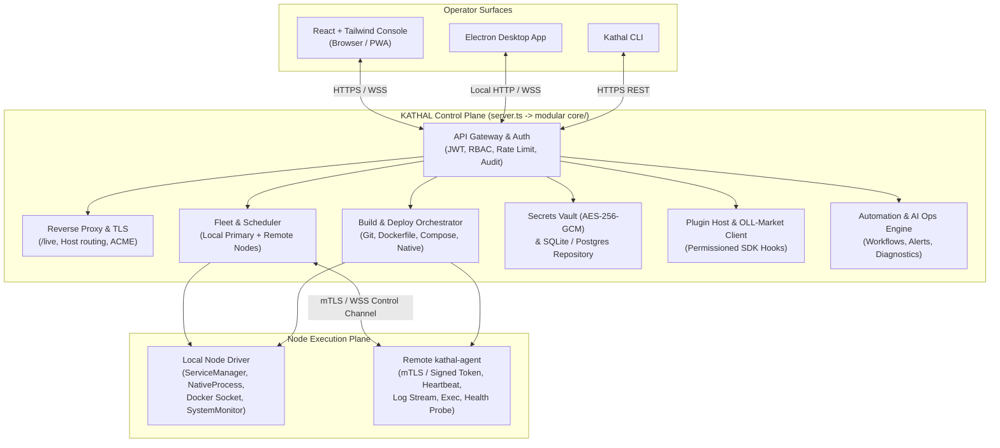
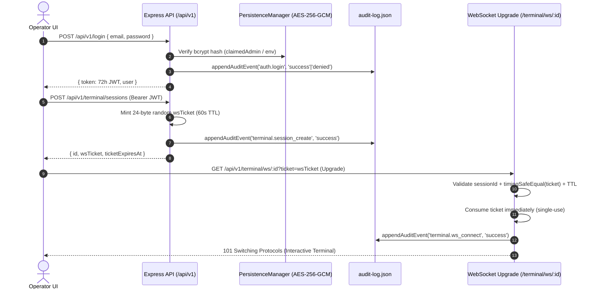

# KATHAL OS — Engineering Audit, Architecture & Evolution Blueprint

> **Scope & Truthfulness Note**: This document covers a verified audit of the local `Kathal-OS/Kathal` workspace (`~28,894` lines across backend, frontend, Electron wrapper, installers, and tests) and read-only inspection via the GitHub REST API of the accessible `Kathal-OS` organization repositories. No remote `Kathal-OS/*` GitHub repositories were modified or pushed from this workspace; Section 9 provides ready-to-apply repository specifications and starters for each ecosystem repository.

---

## Table of Contents

1. [Deliverable 1 — Complete Repository Audit](#deliverable-1--complete-repository-audit)
2. [Deliverable 2 — Existing Architecture Report](#deliverable-2--existing-architecture-report)
3. [Deliverable 3 — Proposed Architecture](#deliverable-3--proposed-architecture)
4. [Deliverable 4 — Competitor Feature Comparison](#deliverable-4--competitor-feature-comparison)
5. [Deliverable 5 — Feature Gap Analysis](#deliverable-5--feature-gap-analysis)
6. [Deliverable 6 — Security Audit & Threat Model](#deliverable-6--security-audit--threat-model)
7. [Deliverable 7 — UI/UX Improvement Plan](#deliverable-7--uiux-improvement-plan)
8. [Deliverable 8 — Database & API Improvement Plan](#deliverable-8--database--api-improvement-plan)
9. [Deliverable 9 — Repository-by-Repository Action Plan](#deliverable-9--repository-by-repository-action-plan)
10. [Deliverable 10 — Prioritized Development Roadmap (Phases 0–6)](#deliverable-10--prioritized-development-roadmap-phases-06)
11. [Deliverable 11 — Testing Strategy](#deliverable-11--testing-strategy)
12. [Deliverable 12 — Deployment & Release Strategy](#deliverable-12--deployment--release-strategy)
13. [Deliverable 13 — Documentation Improvement Plan](#deliverable-13--documentation-improvement-plan)
14. [Deliverable 14 — Implementation Progress Report](#deliverable-14--implementation-progress-report)
15. [Deliverable 15 — Known Limitations & Unresolved Issues](#deliverable-15--known-limitations--unresolved-issues)

---

## Deliverable 1 — Complete Repository Audit

### 1.1 Organization-Wide GitHub Inventory (`Kathal-OS`)

Of the **10 repositories** referenced by the project owner, **9 public repositories** are visible via the GitHub API (`https://api.github.com/orgs/Kathal-OS/repos`); the 10th repository is private/inaccessible without authenticated organization credentials.

| Repository | Default Branch | GitHub Size | Primary Content Observed | Health Assessment |
| :--- | :---: | :---: | :--- | :--- |
| **`Kathal-OS/Kathal`** | `main` | 14,872 KB | Full Node.js/TypeScript control plane (`server.ts`, `src/*`), React + Vite dashboard (`web/*`), Electron wrapper (`electron/main.cjs`), OS installers (`scripts/*`) | **Active core codebase**, recently migrated to Node.js 22 + TypeScript; had legacy Go artifacts in CI/Dockerfile and missing DB persistence (resolved in Phase 0/1 edits) |
| **`Kathal-OS/Kathal-CLI`** | `main` | 0 KB | Empty repository (`HTTP 404` on contents/README) | **Unstarted stub** — requires full CLI bootstrap |
| **`Kathal-OS/OLL-Market`** | `main` | 0 KB | Empty repository (`HTTP 404` on contents/README) | **Unstarted stub** — requires marketplace schema, validator, and catalog index |
| **`Kathal-OS/kathal-plugins-sdk`** | `master` | 2 KB | Single README stub describing a TypeScript SDK | **Stub only** — no source, `package.json`, types, or runtime hooks |
| **`Kathal-OS/kathal-plugins`** | `main` | 1 KB | Single README stub | **Stub only** — no official plugins, manifest schema, or test harness |
| **`Kathal-OS/kathal-examples`** | `master` | 1 KB | Single README stub | **Stub only** — no runnable example stacks or tutorials |
| **`Kathal-OS/kathal-docs`** | `master` | 2 KB | Single README stub referencing an earlier Go + Next.js architecture | **Stale stub** — out of sync with Node.js/React codebase |
| **`Kathal-OS/kathal-ci`** | `master` | 1 KB | Single README stub | **Stub only** — no reusable GitHub Actions workflows |
| **`Kathal-OS/.github`** | `main` | 3,611 KB | Organization `profile/README.md` + `images/` branding assets | **Partial** — missing issue/PR templates, `SECURITY.md`, `CONTRIBUTING.md`, `CODE_OF_CONDUCT.md` |
| *(10th Repository)* | — | Private | Not visible via unauthenticated GitHub API | **Inaccessible** — requires owner access token to audit |

### 1.2 Local Workspace Audit (`Kathal-OS/Kathal`)

- **Codebase Footprint**: `28,894` lines measured across backend TypeScript (`server.ts`: 3,788 LOC; `src/*.ts`: 9,595 LOC), frontend React/JSX (`web/src/*`: 10,879 LOC), tests (`tests/core.test.ts`: 397 LOC), Electron (`electron/main.cjs`: 193 LOC), and install scripts (`scripts/*`: 209 LOC).
- **Strengths Observed**:
  1. Unified OS abstraction (`src/platform.ts`, 735 LOC) supporting Windows (`win32`), macOS (`darwin`), and Linux (`linux`) with pure-Node PATH lookup, venv resolution, safe archive extraction, process-tree termination (`taskkill` / `SIGKILL` groups), and `fs.statfsSync` disk metrics.
  2. Rich **134-app catalog** (`src/catalogPart1.ts`, `catalogPart2.ts`, `catalogPart3.ts`, `appRegistry.ts`) distinguishing `114` Docker-free native apps from `20` explicitly flagged `docker-required` apps.
  3. Solid cross-platform `ServiceManager` (`src/serviceManager.ts`, 840 LOC) and `AppInstallerEngine` (`src/installerEngine.ts`, 1,259 LOC) with `shell: false` execution, HTTPS allowlists, directory confinement, free port reservation, and live HTTP/TCP health checks.
  4. Working `BackupManager` (`src/backupManager.ts`, 908 LOC) with zero-dependency ZIP writer/parser, CRC-32 verification, and Zip-Slip path sanitization.
  5. Live host-process inspection (`src/nativeProcess.ts`), built-in HTTP reverse proxy (`src/proxyConfig.ts` + `server.ts`), WebSocket terminal, and Vite + React SPA (`21` pages) with jackfruit/forest theming (`#080C08` / `#101A10`).
- **Critical Defects Discovered (Pre-Remediation)**:
  1. **CI & Docker Stack Drift**: `.github/workflows/ci.yml` and `Dockerfile` attempted to compile a nonexistent Go `cmd/kathal` binary on `:8080`, failing on every build.
  2. **Ephemeral In-Memory Core State**: First-run claimed admin hash (`claimedAdmin`), platform settings (`webhookSecret`), managed databases, secret env vars, Git repos/logs, registries, networks, volumes, and fleet nodes vanished on server restart.
  3. **Plaintext Secret Exposure**: `GET /api/v1/databases`, `GET /api/v1/env`, and `GET /api/v1/settings` returned plaintext passwords, secret values, and webhook secrets in list/settings responses.
  4. **Long-Lived JWT in WebSocket Query String**: `Terminal.jsx` passed the 72-hour admin JWT in `?token=<jwt>` on WS upgrade URLs, risking proxy/server log leakage, and `POST /api/v1/git/webhook` failed authMiddleware before signature checks ran (nor were HMAC signatures enforced).
  5. **UI Scope & Naming Mismatches**: `web/package.json` declares `vite ^5.3.1` (`esbuild 0.21.5`) while root uses `vite ^8.3.8`; `bun audit` flags `1 high` and `9 moderate` advisories in `vite <=6.4.3`/`launch-editor` and `react-router 6.x`; several pages (`Databases`, `Compose`, `Containers`) manage local metadata without full multi-node orchestration yet.

---

## Deliverable 2 — Existing Architecture Report

### 2.1 Current Runtime Topology

KATHAL OS runs as a **single-process Node.js 22 HTTP + WebSocket monolith (`server.ts`)** that embeds Vite dev middleware (in development) or serves `web/dist` (in production) on port `3000`, while spawning and supervising native child processes on the same host.

- **Control Entry**: `server.ts` mounts:
  1. HTTP security header middleware
  2. Built-in reverse proxy middleware (`/live/<appName>/*` and custom `Host` header routing from `data/reverse-proxy.json`)
  3. JSON body parser (`express.json` with `rawBody` capture)
  4. Protected `/api/v1/*` REST router (`jwt` Bearer auth, except `/health`, `/login`, `/auth/status`, `/auth/setup`, and HMAC-verified Git webhook paths)
  5. `ws` `WebSocketServer` upgrade listener (`/api/v1/terminal/ws/:id`)
- **State & Storage Layer**:
  - `data/registry.json` (`AppRegistry`): 134 app catalog
  - `data/services-state.json` (`ServiceManager`): managed service records & runtime directories
  - `data/reverse-proxy.json` (`ProxyConfigManager`): domain rules & SSL/proxy settings
  - `data/auth-state.json` & `data/platform-state.json` (`PersistenceManager`, newly added in Phase 1): encrypted secrets + atomic JSON persistence
  - `data/audit-log.json` (`PersistenceManager`, newly added in Phase 1): ring-buffered security/operational audit log
  - `data/apps/<app-name>/`: isolated application workspaces (`venv`, `node_modules`, binaries, `.env`)
- **Desktop & Installers**: `electron/main.cjs` spawns `server.ts` if `:3000` is closed and renders the SPA in a native window; `scripts/install.{ps1,sh}` & `install-mac.sh` configure prerequisites and optional OS service units (`Task Scheduler`, `launchd`, `systemd`).

---

## Deliverable 3 — Proposed Architecture

### 3.1 Target Modular Control-Plane + Agent-Plane Architecture

### 3.2 Module Dependency & WebSocket / Auth Sequence

---

## Deliverable 4 — Competitor Feature Comparison

| Feature | KATHAL OS (Current) | Kiri | Coolify | Dokploy | Dokku | CapRover | Portainer | CasaOS |
| :--- | :--- | :--- | :--- | :--- | :--- | :--- | :--- | :--- |
| **OS Support (Control Plane)** | **Windows, macOS, Linux natively** | Linux / Cloud | Linux (Docker) | Linux (Docker) | Linux | Linux (Swarm) | Linux / Windows | Linux (Debian/Armbian) |
| **Docker-Free Native Apps** | **Yes (114/134 native + Python venv + npm + binary)** | No | No | No | Buildpacks/Docker | No (Swarm) | No | No (Docker Compose) |
| **Desktop / Offline Mode** | **Electron + PWA + 0-cloud local mode** | Web | Web | Web | SSH CLI only | Web | Web | Web |
| **App Catalog** | **134+ curated apps** | Limited | ~80+ templates | Templates | Community plugins | One-Click Apps | App Templates | Store catalog |
| **Git Auto-Deploy + Webhooks** | Git clone + HMAC-SHA256 webhooks (Phase 1) | Yes | GitHub/GitLab Apps + PR previews | Yes | `git push dokku` | CLI / Tarball / Git | Stack GitOps | No |
| **Dockerfile / Nixpacks Builds** | Partial (Compose/Git; no Nixpacks) | Buildpacks | Nixpacks + Dockerfile + Compose | Nixpacks + Railpack + Dockerfile | Buildpacks + Dockerfile | Dockerfile + Captain-def | Image deploy | No |
| **Multi-Server Fleet** | Inventory + TCP probe (Phase 1); remote agent Phase 3 | Cloud-managed | SSH remote servers | Multi-node Swarm / Remote | Single-host | Swarm cluster | Multi-environment Agents | Single-node |
| **Managed Databases** | Metadata + connection vault (real DB daemons Phase 3) | Managed | Live DB containers + backups | Live DB + S3 backups | Official DB plugins | One-Click DBs | Stack-only | App-level |
| **HTTPS / ACME TLS** | Built-in localhost/domain HTTP proxy (ACME Phase 2) | Auto TLS | Traefik + Caddy ACME | Traefik ACME | Let's Encrypt plugin | Nginx + Certbot | Manual/Proxy | Manual |
| **RBAC & Team Audit** | Single admin + persistent Audit Log (RBAC Phase 2) | Teams | Teams + RBAC | Teams + RBAC | SSH key ACLs | Single admin | RBAC + Teams | Single user |
| **CLI & Plugin SDK** | Planned (`Kathal-CLI`, `kathal-plugins-sdk` stubs) | CLI | API | CLI / API | First-class CLI + Bash plugins | First-class CLI | API + Extensions | Minimal |

---

## Deliverable 5 — Feature Gap Analysis

### 5.1 Gaps Worth Closing Immediately (High Value)
1. **Production Database Layer (`SQLite` + `Drizzle`/migrations)** replacing file-only `MemoryStore` for deployments, audit history, RBAC users, and jobs.
2. **Real Build & GitOps Engine** (Dockerfile build + multi-stage logs + rollback revisions + PR/branch deploy previews, matching Coolify/Dokploy).
3. **Automatic HTTPS (ACME / Let's Encrypt or Caddy integration)** for public VPS deployments, complementing built-in local HTTP proxying.
4. **Live Managed Database Runtimes** (spawning real Postgres/Redis/Mongo/MySQL processes or containers with real `pg_dump`/backup schedules).
5. **Working `Kathal-CLI` + Signed `kathal-agent`** so headless servers and multi-server fleets work without exposing SSH root keys permanently.

### 5.2 Features Worth Improving Beyond Competitors
- **Zero-Docker Native First-Class Execution**: Unlike Coolify/Dokploy/CasaOS, KATHAL already excels at running Node, Python `venv`, and native binaries directly on Windows, macOS, and Linux — doubling down on native dependency health checks and crash auto-restarts creates a true differentiator on laptops, workstations, and low-RAM SBCs.
- **Unified AI-Assisted Root Cause Diagnostics**: Rather than generic chat widgets, tie AI diagnostics directly to captured `ServiceManager` logs, health probes, port conflicts, and audit events.

### 5.3 Features KATHAL Should Intentionally Avoid (Anti-Bloat)
- Avoid hard dependencies on **Docker Swarm** (CapRover's operational burden) or mandatory **Kubernetes** in v1 (defer Kubernetes import/bridge to Phase 6).
- Avoid mandatory **SaaS cloud login / license servers**; keep core KATHAL 100% air-gap and offline capable.

---

## Deliverable 6 — Security Audit & Threat Model

### 6.1 Entry Points & Trust Boundaries
1. **Public Unauthenticated Surface**: `GET /api/v1/health`, `GET /api/v1/auth/status`, `POST /api/v1/auth/setup`, `POST /api/v1/login`, `/live/<appName>/*` reverse proxy, and Git webhook endpoints (`POST /api/v1/git/webhook`, `POST /api/v1/webhooks/git/:id`).
2. **Authenticated Control Surface**: All remaining `/api/v1/*` routes (`Bearer` JWT) and `WS /api/v1/terminal/ws/:id` (`wsTicket` query credential).
3. **Host Execution Boundary**: `ServiceManager`, `AppInstallerEngine`, `NativeProcessService`, Git clone, File Manager uploads/edits, and Backup archive restore.

### 6.2 Security Findings & Status

| Finding | Severity | Status | Evidence / Remediation |
| :--- | :---: | :---: | :--- |
| **JWT token transmitted in WebSocket URL query parameter** | High | **Fixed** | `POST /api/v1/terminal/sessions` issues a 60s single-use `wsTicket`; `server.ts` upgrade handler verifies with `timingSafeEqual` and deletes before `handleUpgrade`. |
| **Unprotected / unreachable Git webhook authentication** | High | **Fixed** | `authMiddleware` delegates webhook routes into `verifyWebhookSignature()`, enforcing `X-Hub-Signature-256` (HMAC-SHA256 on raw request bytes) or `X-Kathal-Webhook-Secret` / `X-Gitlab-Token`; failures log to audit trail and return `401`. |
| **Plaintext credentials returned in list/settings endpoints & unencrypted at rest** | High | **Fixed** | Added `PersistenceManager` AES-256-GCM encryption at rest (`KATHAL_VAULT_KEY` or `0o600` `.vault-key`); `serializeDatabase()`, `serializeEnvVar()`, and `serializeSettings()` mask secrets on GET/POST and reveal only on explicit POST endpoints with audit events. |
| **Admin credentials, fleet, webhooks, DBs, and audit trail lost on restart** | High | **Fixed** | Persisted `auth-state.json`, `platform-state.json`, and `audit-log.json` atomically (`0o600`). |
| **Missing baseline HTTP security headers** | Medium | **Fixed** | Added `X-Content-Type-Options: nosniff`, `Referrer-Policy: strict-origin-when-cross-origin`, `Permissions-Policy`, `X-DNS-Prefetch-Control: off` (preserving iframe embed compatibility). |
| **Fleet remote probe DNS/SSRF risk on metadata or link-local endpoints** | High | **Fixed (Phase 1.5)** | `FleetService` validates host syntax and resolves all A/AAAA DNS records before probing (`resolveAndValidateTargetIp`), blocking loopback, link-local/metadata (`169.254.0.0/16`, `fe80::/10`), multicast, and optionally RFC1918 ranges via `KATHAL_FLEET_ALLOW_PRIVATE_NETWORKS`. |
| **Single-admin stateless JWT without RBAC, session revocation, or cookie CSRF protection** | Critical | **Fixed (Phase 1.5)** | Replaced with SQLite `users`/`roles`/`permissions`/`sessions` tables, `scrypt` (`N=32768`) + legacy `bcrypt` upgrade, `HttpOnly` cookie + CSRF `Origin`/`X-Requested-With` guards, and 5-role / 26-permission backend RBAC (`requirePermission`). |
| **Vault v1 silent key overwrite risk & missing key rotation** | High | **Fixed (Phase 1.5)** | Added `VaultManager` (`enc:v2:<kid>:...` with AAD), strict `VaultLockedError` anti-overwrite recovery when keys are missing/mismatched, and Owner-only transactional `POST /api/v1/vault/rotate`. |
| **Frontend workspace dependency advisories (`vite 5.4.21`, `react-router 6.30.6`)** | Low | **Scheduled (Phase 2)** | Root workspace runs `vite ^8.3.8`; align `web/package.json` `vite` and `react-router-dom` cleanly in Phase 2 after full router compatibility regression checks. |

*(Full step-by-step verification traces are documented in `/walkthrough.md`.)*

---

## Deliverable 7 — UI/UX Improvement Plan

- **Design Tokens & Visual Cohesion**: Preserve KATHAL's dark forest (`#080C08` / `#101A10`) + green/yellow/red jackfruit telemetry palette with optional high-contrast light mode variables (`--kathal-bg`, `--kathal-surface`, `--kathal-border`, `--kathal-text`).
- **Information Architecture Consolidation (21 current views → 14 structured sections)**:
  - Group `Templates` + `AppDetail` under **Marketplace**
  - Group `Containers`, `Images`, `Volumes` under **Containers / Workloads**
  - Group `Network`, `ProxyManager` under **Networking**
  - Elevate **Fleet** (currently embedded in `Monitoring`) into its own top-level route once multi-node SSH/agent actions land in Phase 3
  - Replace hardcoded browser alerts/missing error states with unified toast/banner feedback, loading skeletons, accessible confirmation modals, search/filter/sort bars, and tabular numeric alignment.

---

## Deliverable 8 — Database & API Improvement Plan

### 8.1 Relational Schema Target (`SQLite` local default + `PostgreSQL` optional for HA)
Normalize `platform-state.json` into versioned Drizzle migrations covering all 21 core entities:
`users`, `roles`, `permissions`, `role_permissions`, `servers`, `agents`, `applications`, `deployments`, `containers`, `images`, `volumes`, `networks`, `databases`, `domains`, `certificates`, `secrets`, `backups`, `workflows`, `plugins`, `notifications`, `audit_events`, and `system_settings`.

### 8.2 API Contract Standards (`/api/v1/*`)
- Standard envelope for paginated collections (`{ items, total, page, pageSize }`) while keeping backward-compatible endpoints during transition.
- Central schema validation (Zod or lightweight typed validators) returning structured `400` field errors.
- Per-endpoint rate limiting on auth, reveal, backup import, and webhook endpoints + optional `Idempotency-Key` header support on `/deploy`, `/install`, `/backups`, and `/restore`.

---

## Deliverable 9 — Repository-by-Repository Action Plan

1. **`Kathal-OS/Kathal` (Active in this workspace)**: Modularize `server.ts` (`3,788` LOC) into domain route modules (`src/routes/*.ts`), finalize SQLite storage, real Dockerfile builder, ACME TLS, and RBAC.
2. **`Kathal-OS/Kathal-CLI` (Currently empty)**: Bootstrap TypeScript CLI (`commander` + `undici`) with `~/.kathal/config.json`, `kathal auth login`, `kathal status`, `kathal fleet list|probe`, `kathal apps list|start|stop|logs`, `kathal deploy`, and `kathal backup export`.
3. **`Kathal-OS/OLL-Market` (Currently empty)**: Create `registry/` JSON manifests adhering to `src/templateTypes.ts`, JSON Schema validator (`npm run validate`), automated GitHub Actions PR validation, and signed `index.json` endpoint consumable by `AppRegistry`.
4. **`Kathal-OS/kathal-plugins-sdk` (README stub)**: Publish `@kathal/plugins-sdk` exporting `KathalPlugin`, lifecycle hooks (`onInstall`, `onDeploy`, `onHealthCheck`, `onMenuRegister`), permission scopes, and mock test harness.
5. **`Kathal-OS/kathal-plugins` (README stub)**: Monorepo under `/plugins/<name>` containing first-party plugins (`cloudflare-tunnel`, `discord-alerts`, `s3-backup-sync`, `prometheus-exporter`) tested against `@kathal/plugins-sdk`.
6. **`Kathal-OS/kathal-examples` (README stub)**: Runnable templates (`node-express-api`, `python-fastapi-app`, `static-site-proxy`, `fullstack-postgres-compose`, `sample-kathal-plugin`) verified in CI.
7. **`Kathal-OS/kathal-docs` (Stale README)**: Initialize Starlight/Docusaurus docs covering Windows/macOS/Linux install, `KATHAL_VAULT_KEY`, reverse proxy, webhook HMAC signing, API v1 reference, and troubleshooting.
8. **`Kathal-OS/kathal-ci` (README stub)**: Publish reusable workflows (`node-ci.yml`, `docker-multiarch.yml`, `security-scan.yml`, `release-tarball.yml`) consumed via `uses: Kathal-OS/kathal-ci/.github/workflows/...`.
9. **`Kathal-OS/.github` (Profile README only)**: Add `SECURITY.md`, `CONTRIBUTING.md`, `CODE_OF_CONDUCT.md`, bug/feature issue forms, and `.github/PULL_REQUEST_TEMPLATE.md`.

---

## Deliverable 10 — Prioritized Development Roadmap (Phases 0–6)

Each task below includes all 9 required engineering tracking fields.

### Task P0-1 — Align CI Pipeline & Container Packaging with Node.js 22
- **Task name**: Replace broken Go CI & Dockerfile with Node 22 build/test/release workflows
- **Problem**: `.github/workflows/ci.yml` and `Dockerfile` attempted `go build ./cmd/kathal` on port `8080`, failing on a TypeScript/React codebase running on port `3000`.
- **Proposed solution**: Multi-stage `node:22-alpine` Dockerfile running `tsx server.ts` on `3000` with `/api/v1/health` `HEALTHCHECK`; GitHub Actions running `npm run lint`, `npm test`, `npm run build`, multi-arch GHCR push, and tagged portable release tarballs.
- **Affected files or repositories**: `Kathal`: `.github/workflows/ci.yml`, `Dockerfile`, `docker-compose.yml`
- **Dependencies**: None
- **Priority**: P0 (Critical)
- **Implementation status**: **Completed**
- **Testing requirements**: `npm run lint`, `npm run build`, `docker build` dry run / CI verification
- **Acceptance criteria**: CI runs lint, tests, and build without referencing Go; Docker exposes `:3000` with `/data` volume and passing health check.

### Task P0-2 — Automated Unit & Integration Test Harness
- **Task name**: Establish `node:test` test baseline for core utilities and API security
- **Problem**: Zero automated tests existed (`package.json` had no `test` script), leaving update checks, ZIP handling, auth, and security invariants unverified.
- **Proposed solution**: Add `"test": "tsx --test tests/*.test.ts"` and `tests/core.test.ts` testing both success and adversarial/failure cases against isolated temp `KATHAL_DATA_DIR`.
- **Affected files or repositories**: `Kathal`: `package.json`, `tests/core.test.ts`
- **Dependencies**: P0-1
- **Priority**: P0 (Critical)
- **Implementation status**: **Completed** (`12/12` tests passing)
- **Testing requirements**: `npm test` covering semver, Zip-Slip/CRC failures, AES-GCM tamper detection, auth/lockout, redaction, webhook HMAC, WS ticket replay, fleet, audit.
- **Acceptance criteria**: `npm test` exits `0` reproducibly without mutating workspace `./data/`.

### Task P1-1 — Encrypted Persistence Vault, Auth Durability & Persistent Audit Log
- **Task name**: Persist admin credentials, settings, DBs, env secrets, fleet, and audit events with AES-256-GCM encryption at rest
- **Problem**: Restarting the server wiped claimed admin credentials, DB passwords, secret env vars, Git repos, registries, and webhook secrets, and there was no audit trail.
- **Proposed solution**: Build `src/persistence.ts` (`PersistenceManager`) using `KATHAL_VAULT_KEY` (or auto-generated `0o600` `.vault-key`), atomic temp+rename writes, and an append-only ring-buffered `audit-log.json` exposed via `GET /api/v1/audit`.
- **Affected files or repositories**: `Kathal`: `src/persistence.ts`, `server.ts`, `.env.example`, `web/src/pages/Monitoring.jsx`
- **Dependencies**: P0-2
- **Priority**: P0 (Critical)
- **Implementation status**: **Completed**
- **Testing requirements**: Encryption tamper test, disk redaction assertion (`!rawDisk.includes(secret)`), reload round-trip test, `GET /api/v1/audit` integration test.
- **Acceptance criteria**: No plaintext secret values appear in `platform-state.json`; admin login survives restart; audit events log auth, reveals, deploys, fleet, and denials.

### Task P1-2 — Credential Redaction, Webhook HMAC & Single-Use WebSocket Tickets
- **Task name**: Eliminate plaintext secret leakage and query-string JWTs
- **Problem**: `/databases`, `/env`, `/settings` returned plaintext secrets; terminal WS passed 72h JWT in `?token=`; Git webhook endpoint lacked HMAC signature verification and was blocked by Bearer auth.
- **Proposed solution**: Serialize masked records on reads; add audited `/env/:key/reveal` and `/settings/reveal-webhook`; require raw-body `X-Hub-Signature-256` HMAC-SHA256 or secret header on Git webhooks; replace WS `?token=` with 60s single-use `wsTicket` validated via `timingSafeEqual`.
- **Affected files or repositories**: `Kathal`: `server.ts`, `web/src/pages/Terminal.jsx`, `web/src/pages/Env.jsx`, `web/src/pages/Settings.jsx`
- **Dependencies**: P1-1
- **Priority**: P0 (Critical)
- **Implementation status**: **Completed**
- **Testing requirements**: Integration tests rejecting `?token=`, rejecting ticket replay, rejecting missing/forged webhook signatures, verifying masked GET responses.
- **Acceptance criteria**: All redaction, HMAC, and single-use ticket assertions pass in `npm test` and live UI flows work seamlessly.

### Task P1-3 — Fleet Node Inventory & TCP Reachability Foundation
- **Task name**: Register, persist, probe, and display local and remote infrastructure nodes
- **Problem**: Fleet management existed only as a conceptual requirement with no server inventory or reachability endpoints.
- **Proposed solution**: Add `/api/v1/fleet/servers` (`GET`, `POST`, `POST /:id/probe`, `DELETE`) backed by persistent `fleetServers`, live local node metrics, real `net.createConnection` latency probes, metadata IP blocking, and Fleet table in `Monitoring.jsx`.
- **Affected files or repositories**: `Kathal`: `src/persistence.ts`, `server.ts`, `web/src/pages/Monitoring.jsx`
- **Dependencies**: P1-1
- **Priority**: P1 (High)
- **Implementation status**: **Completed** (MVP inventory & probe; remote agent execution queued for Phase 3)
- **Testing requirements**: Registration validation, SSRF metadata rejection (`169.254.169.254` -> `400`), control-plane delete protection, probe state persistence.
- **Acceptance criteria**: Nodes persist across restarts; control plane cannot be deleted; invalid hosts rejected.

### Task P1-4 — Server Modularization, SQLite Migration, Multi-User RBAC & Vault v2 (Phase 1.5)
- **Task name**: Extract core security/domain modules, migrate to `node:sqlite` (`kathal.db`), and ship multi-user Auth + 5-role RBAC + Vault v2
- **Problem**: Monolithic `server.ts`, flat JSON files, single-admin JWTs, and unversioned Vault v1 keys hindered team access control, auditability, session revocation, and transactional consistency.
- **Proposed solution**: Adopt Node 22 `node:sqlite` (`src/database/`), idempotent `migrateLegacyJsonToSqlite()` preserving Phase 1 JSON backups, `VaultManager` (`enc:v2:`) + rotation, `AuthService` (`scrypt`, revocable sessions, CSRF cookies, lockout), `RbacService` (5 roles, 26 permissions), `TerminalGateway`, `FleetService`, `AuditService`, modular `src/routes/*`, and Light/Dark permission-aware React views.
- **Affected files or repositories**: `Kathal`: `server.ts`, `src/{config,database,repositories,security,auth,audit,fleet,middleware,websocket,routes}/*`, `web/src/*`, `tests/phase1_5.test.ts`
- **Dependencies**: P1-1, P1-3
- **Priority**: P1 (High)
- **Implementation status**: **Completed (`23/23` tests passing; core security/platform domains modularized while keeping remaining runtime handlers intact in `server.ts`)**
- **Testing requirements**: SQLite WAL/FK/backup/rollback tests, repeatable JSON migration tests, Vault v2 + lock recovery + key rotation tests, 5-role RBAC & escalation tests, session lockout/CSRF/WS teardown tests, Fleet DNS/SSRF & agent heartbeat tests.
- **Acceptance criteria**: Zero regressions on existing `/api/v1/*` contracts (`12/12` core tests + `11/11` Phase 1.5 tests pass cleanly).

### Task P2-1 — Multi-User RBAC, Revocable Sessions & Dockerfile/Git Build Engine
- **Task name**: Role-based access control (`owner`, `operator`, `viewer`) + real Dockerfile/Git deployment pipelines with revision rollbacks
- **Problem**: Single admin account lacks team separation; Git deployment performs shallow clone/local start without full Dockerfile image builds, immutable release tags, or one-click rollback.
- **Proposed solution**: Implement RBAC middleware checked against persisted `users`/`roles`, and build a queue-backed `DeploymentManager` tracking build logs, commit SHAs, health verification gates, and previous revision rollback.
- **Affected files or repositories**: `Kathal`: `src/rbac.ts`, `src/deploymentManager.ts`, `web/src/pages/GitDeploy.jsx`, `Settings.jsx`
- **Dependencies**: P1-4
- **Priority**: P1 (High)
- **Implementation status**: **Planned (Phase 2)**
- **Testing requirements**: Unauthorized role escalation test (`viewer` denied `POST /deploy`), failed-build auto-keep-previous test, rollback integration test.
- **Acceptance criteria**: Failed deploys never break live routes; viewers cannot mutate infrastructure; rollbacks restore prior working release.

### Task P2-2 — Automated HTTPS (ACME / Let's Encrypt) & Frontend Vite Alignment
- **Task name**: Integrated ACME certificate issuance/renewal and upgrade `web/package.json` dependencies
- **Problem**: `autoSsl` and `forceHttps` settings are persisted but do not yet issue real TLS certificates; `web/package.json` trails root `vite 8.3.8`.
- **Proposed solution**: Integrate ACME HTTP-01/DNS-01 challenge handler or managed Caddy sidecar config generator + align `web/package.json` to Vite 8 & clean router dependency versions.
- **Affected files or repositories**: `Kathal`: `src/tlsManager.ts`, `src/proxyConfig.ts`, `web/package.json`
- **Dependencies**: P1-4
- **Priority**: P1 (High)
- **Implementation status**: **Planned (Phase 2)**
- **Testing requirements**: Staging ACME mock/pebble renewal test, HTTP->HTTPS redirect test, `bun audit` clean verification.
- **Acceptance criteria**: Enabled domains serve valid TLS and auto-renew before 30-day expiry.

### Task P3-1 — Remote `kathal-agent` & Managed Database Daemons
- **Task name**: Encrypted mTLS/WebSocket remote node agent + real Postgres/Redis/MySQL/Mongo runtime lifecycle and restore
- **Problem**: Remote servers currently support TCP reachability probing only; managed databases store metadata/connection strings without spawning actual database engines.
- **Proposed solution**: Build lightweight cross-platform `kathal-agent` binary/script registering over mTLS/signed token for remote metrics, container/service control, and log streaming; wire `DatabaseManager` to spawn real Docker or native database instances with automated backup/restore (`pg_dump`/`mongodump`).
- **Affected files or repositories**: `Kathal`, `kathal-ci`: `src/agent/*`, `src/databaseManager.ts`, `web/src/pages/Databases.jsx`
- **Dependencies**: P2-1
- **Priority**: P2 (Medium-High)
- **Implementation status**: **Planned (Phase 3)**
- **Testing requirements**: Agent disconnect/reconnect resilience test, DB credential rotation & backup/restore verification test.
- **Acceptance criteria**: Multi-node deployments execute remotely with live log streams; databases accept live TCP client queries and restore cleanly.

### Task P4-1 — Ecosystem Activation (`Kathal-CLI`, `OLL-Market`, `kathal-plugins-sdk`, `kathal-docs`)
- **Task name**: Bootstrap and ship first-party CLI, plugin SDK, marketplace catalog, and documentation site
- **Problem**: Ecosystem repositories (`Kathal-CLI`, `OLL-Market`, `kathal-plugins-sdk`, `kathal-plugins`, `kathal-examples`, `kathal-docs`, `kathal-ci`) are empty or stubbed.
- **Proposed solution**: Implement deliverables specified in Deliverable 9 with shared semver release tags via `kathal-ci`.
- **Affected files or repositories**: All 8 companion `Kathal-OS` repositories
- **Dependencies**: P1-4, P2-1
- **Priority**: P2 (Medium)
- **Implementation status**: **Planned (Phase 4)**
- **Testing requirements**: CLI E2E suite against local test server, plugin permission sandbox tests, `OLL-Market` JSON schema CI checks.
- **Acceptance criteria**: Operators can deploy apps from `Kathal-CLI`, install signed plugins from `OLL-Market`, and follow verified guides in `kathal-docs`.

### Task P5-1 — Workflow Automation & Context-Aware AI Infrastructure Ops
- **Task name**: Event-driven infrastructure automation workflows and diagnostic assistant
- **Problem**: No automated trigger-action workflows (e.g., high disk alert → prune/notify; webhook → deploy → smoke test → Slack/Discord) or log-aware AI troubleshooting exist.
- **Proposed solution**: Build `WorkflowEngine` consuming audit/monitoring/health events and optional opt-in local/BYO-model AI diagnostics (`Ollama` local-first compatible) grounded strictly in sanitized logs and system metrics.
- **Affected files or repositories**: `Kathal`: `src/workflowEngine.ts`, `src/aiOps.ts`, `web/src/pages/Automation.jsx`, `Assistant.jsx`
- **Dependencies**: P3-1, P4-1
- **Priority**: P3 (Medium-Low)
- **Implementation status**: **Planned (Phase 5)**
- **Testing requirements**: Trigger loop prevention tests, secret-redaction checks before sending diagnostics to any external LLM endpoint.
- **Acceptance criteria**: Zero secrets leaked in diagnostic prompts; workflows recover cleanly across restarts.

### Task P6-1 — Kubernetes Bridge, Multi-Tenant Orgs & Mobile PWA Polish
- **Task name**: Optional Kubernetes cluster adapter, multi-tenant namespaces, and mobile-responsive operations view
- **Problem**: Enterprise clusters need namespace isolation and optional k8s workload visibility beyond single/fleet nodes.
- **Proposed solution**: Add optional read/deploy `kubeconfig` adapter plugin + multi-tenant org scoping and touch-friendly alert triage views.
- **Affected files or repositories**: `Kathal`, `kathal-plugins`
- **Dependencies**: P5-1
- **Priority**: P4 (Future)
- **Implementation status**: **Planned (Phase 6)**
- **Testing requirements**: Kind/k3s integration tests, tenant isolation penetration checks.
- **Acceptance criteria**: Tenant A cannot view or mutate Tenant B workloads or secrets.

---

## Deliverable 11 — Testing Strategy

1. **Test Pyramid**:
   - **Unit (`tests/*.test.ts`)**: Semver parser, ZIP CRC/Zip-Slip guards, AES-256-GCM encryption/tamper, OS path/domain validators.
   - **API & Security Integration (`tests/*.test.ts`)**: Ephemeral `startServer(0)` + isolated temp `KATHAL_DATA_DIR`, testing unauthenticated rejections (`401`), account lockout (`429`), secret masking, HMAC webhook checks (`401` on missing/bad, `200` on valid), single-use WebSocket ticket rejection on `?token=` and replay, fleet validation (`400` on metadata IP), and audit log assertions.
   - **Frontend Component & E2E (Phase 1.5–2)**: Vitest + React Testing Library for UI forms/states; Playwright smoke suite exercising setup → login → app catalog search → proxy creation → terminal ticket connect → backup export.
   - **Clean OS & Upgrade Matrix**: Automated GitHub Actions runners on `ubuntu-latest`, `macos-latest`, and `windows-latest` running clean install scripts and upgrade-from-prior-backup verification.
2. **Failure-Case Policy**: Every suite must explicitly assert negative/adversarial scenarios (corrupted archive, tampered ciphertext, bad credentials, unreachable host, port collision, expired/reused WS ticket).

---

## Deliverable 12 — Deployment & Release Strategy

- **Supported Distribution Channels**:
  1. **Native OS Scripts**: `scripts/install.ps1` (Windows Scheduled Task), `scripts/install-mac.sh` (`launchd`), `scripts/install.sh` (`systemd`)
  2. **OCI Container**: Multi-stage `node:22-alpine` `Dockerfile` (`linux/amd64`, `linux/arm64`) published to `ghcr.io/kathal-os/kathal` on `main` pushes
  3. **Portable Release Tarball**: `.github/workflows/ci.yml` packages `kathal-os-<tag>-portable.tar.gz` + `checksums.txt` on `v*` Git tags
  4. **Desktop Window**: Cross-platform Electron wrapper (`npm run desktop`) & offline-capable PWA manifest
- **Upgrade & Rollback**: Auto-update checker compares `KATHAL_VERSION` against GitHub Releases; pre-upgrade compressed zip backup (`BackupManager`) enables deterministic state restore.

---

## Deliverable 13 — Documentation Improvement Plan

- **Primary Docs Updated Now**: `/README.md` and `/docs/AUDIT_AND_ARCHITECTURE.md` aligned with actual Node.js 22 runtime, `KATHAL_VAULT_KEY`, single-use `wsTicket`, Fleet & Audit APIs, and `npm test`.
- **Next Documentation Milestones (`kathal-docs` & `.github`)**:
  - OpenAPI 3.1 spec generated cleanly from Express route modules
  - Step-by-step Reverse Proxy + HTTPS domain guide (local LAN vs public VPS)
  - Webhook HMAC verification snippets for GitHub, GitLab, and Forgejo/Gitea
  - Contributor guide, security disclosure policy (`SECURITY.md`), and plugin developer tutorial.

---

## Deliverable 14 — Implementation Progress Report

Completed and verified in this engineering cycle:

| Area | Change Summary | Files Modified / Created |
| :--- | :--- | :--- |
| **CI / Container Drift** | Replaced broken Go `cmd/kathal` CI/Dockerfile with working Node.js 22 + Vite build, test, audit, Docker (`3000`), and tagged portable tarball release workflows | `.github/workflows/ci.yml`, `Dockerfile`, `docker-compose.yml` |
| **Encrypted Persistence Vault & Audit** | Created `PersistenceManager` with AES-256-GCM encryption at rest (`KATHAL_VAULT_KEY` / `0o600` `.vault-key`), atomic writes for `auth-state.json` + `platform-state.json`, and 1,000-entry `audit-log.json` | `src/persistence.ts`, `.env.example` |
| **API & WebSocket Hardening** | Added security headers; captured `req.rawBody`; persisted admin setup; redacted DB/env/webhook secrets on list/read with audited reveal endpoints; fixed & enforced webhook HMAC-SHA256 verification; replaced WS `?token=<jwt>` with 60s single-use `wsTicket`; fixed `PORT=0` startup | `server.ts`, `web/src/pages/Terminal.jsx`, `web/src/pages/Env.jsx`, `web/src/pages/Settings.jsx` |
| **Fleet & Audit Visibility** | Implemented `/api/v1/fleet/servers` (register, TCP probe, metadata IP rejection, delete guard) and `/api/v1/audit` endpoints + UI cards | `server.ts`, `src/persistence.ts`, `web/src/pages/Monitoring.jsx` |
| **Automated Test Suite** | Added `npm test` script, 12 Phase 1 security tests (`tests/core.test.ts`), and 11 Phase 1.5 SQLite/Auth/RBAC/Vault/WS/Fleet/Audit tests (`tests/phase1_5.test.ts`) (`23/23` passing) | `package.json`, `tests/core.test.ts`, `tests/phase1_5.test.ts` |
| **SQLite, Multi-User RBAC & Vault v2 (Phase 1.5)** | Built `node:sqlite` DB manager, 32-table initial migration, repeatable JSON-to-SQLite migrator, `scrypt` multi-user auth, `HttpOnly`+CSRF cookies, 5-role/26-perm RBAC, Vault `enc:v2:` + rotation, hardened WS gateway, Fleet DNS checks + agent heartbeat, and Light/Dark RBAC UI | `src/{config,database,repositories,security,auth,audit,fleet,middleware,websocket,routes}/*`, `web/src/*` |
| **Architecture & Security Docs** | Authored audit/architecture blueprint, Phase 1.5 audit, SQLite migration, Vault v2, RBAC/Auth, Fleet protocol, Release Notes, security walkthrough + PoC traces, `.env.example`, and `README.md` | `docs/*.md`, `walkthrough.md`, `README.md`, `.env.example` |

---

## Deliverable 15 — Known Limitations & Unresolved Issues

1. **Remote Repositories Read-Only**: Companion `Kathal-OS` repositories (`Kathal-CLI`, `OLL-Market`, `kathal-plugins-sdk`, `kathal-plugins`, `kathal-examples`, `kathal-docs`, `kathal-ci`, `.github`) remain untouched on GitHub because this workspace does not push to remote repositories; 1 of the 10 repositories is private/inaccessible.
2. **Managed Database Engines Are Metadata-Only Today**: `/api/v1/databases` securely encrypts credentials with Vault v2 in SQLite and generates connection strings, but does not yet spawn live `postgres`/`mysqld`/`mongod`/`redis-server` OS processes or restore dumps (slated for Phase 3).
3. **Remaining Runtime Routes Inside `server.ts`**: Phase 1.5 extracted auth, users/RBAC, vault, SQLite admin, audit, fleet, auth middleware, and the WebSocket terminal gateway into `src/{auth,security,database,repositories,audit,fleet,middleware,websocket,routes}/*` (`3,551` lines remaining in `server.ts` for app store, installer, service engine, proxy, git, compose, files, backups, and env). Extracting those remaining endpoints is tracked for Phase 2 so existing Phase 1 behavior stays zero-regression during Phase 1.5.
4. **Remote Fleet Execution Is Probe + Heartbeat**: `/api/v1/fleet/servers` now persists `server_status_history`, validates DNS/CIDRs, and authenticates signed `kathal-agent` heartbeats (`POST /api/v1/fleet/agent/heartbeat`), while remote app deployment and interactive log streaming over the agent await the standalone `kathal-agent` rollout in Phase 3.
5. **Frontend Workspace Package Alignment (`web/package.json`)**: `web/package.json` still lists `vite ^5.3.1` / `react-router-dom ^6.23.1` while root `package.json` builds using `vite ^8.3.8`; aligning `web/package.json` with a full Playwright browser smoke test is slated for Phase 2.
6. **Build & Git Integration Scope**: `GitDeploy` clones and launches apps natively without full multi-stage Dockerfile container builds, ACME TLS issuance, or automated revision rollbacks yet (Phase 2).
